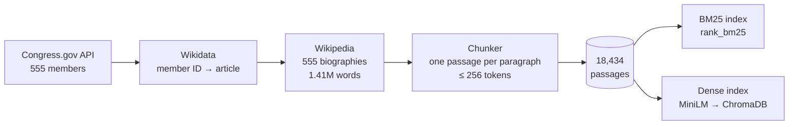
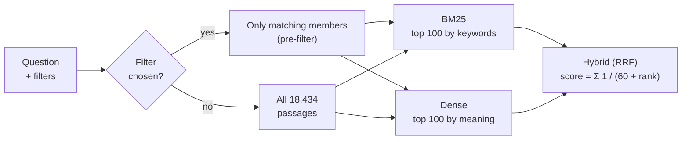
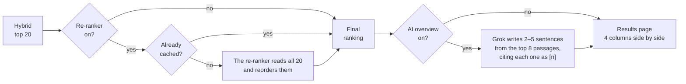

# Congress App Info 556

Search over biographies of the 119th Congress. Class project for INFO/ISTA 456/556 (Text Retrieval and Web Search), University of Arizona, Fall 2026.

It compares four ways to search 18,434 Wikipedia passages about the 555 members of the 119th Congress:
BM25 (keyword), dense embeddings (all-MiniLM-L6-v2 + ChromaDB), hybrid (Reciprocal Rank Fusion), and a
a re-ranker over the hybrid top 20. Methods are scored with nDCG@10, Recall@10, and MRR on 50 test
questions (20 keyword, 20 conceptual, 10 filtered by chamber, party, or state) using pooled relevance labels.

**Try it:** https://congress-search.juannadal.workers.dev (no install needed; the first visit after a quiet spell takes about 30 seconds to wake up).

## How it works

### Step 1: gather the biographies and build the indexes (done once)

Members are matched to their Wikipedia articles by their official Congress ID (Wikidata property P1157), not by
name. Reference lists and other non-prose sections are dropped. Every passage keeps its member's chamber, party, and
state for filtering. Code: `scripts/`.

### Step 2: search by keywords and by meaning, then fuse (every search)

Chamber, party, and state filters are applied before ranking. BM25 keeps its word statistics from the whole corpus,
so a filtered search scores passages the same way an unfiltered one does. Code: `retrieval/bm25.py`,
`retrieval/dense.py`, `retrieval/hybrid.py`.

### Step 3: re-rank, then summarize with Grok (every search, optional)

Every re-ranker answer is cached, so the 50 test questions cost nothing and the evaluation can be repeated exactly. On
the public site each browser session can make up to 10 new paid AI calls, shared by the re-ranker and the overview (a
new question can use one of each), within a site-wide daily cap of 200. The overview never changes a ranking. Code:
`retrieval/rerank.py`, `retrieval/overview.py`.

### The algorithms

| Method | How it scores a passage | nDCG@10 |
|---|---|---|
| BM25 (keyword) | Term frequency × inverse document frequency, normalized for passage length (rank_bm25, k1 = 1.5, b = 0.75, stemming, NLTK stop words) | 0.624 |
| Dense (meaning) | Cosine similarity between all-MiniLM-L6-v2 embeddings of the question and the passage (384 dimensions, ChromaDB) | 0.589 |
| Hybrid (RRF) | Sum of 1 / (60 + rank) over the BM25 and dense top 100, so the two score scales never have to be compared | 0.730 |
| Re-ranker | A model reads the question and the hybrid's top 20 passages and returns their order as JSON (listwise re-ranking) | 0.959 |

Scores are over 50 test questions (20 keyword, 20 conceptual, 10 filtered). Hybrid beats both BM25 and dense
(randomization test, Holm-corrected p < 0.01). Full results, including per-group scores and significance tests, are
in `eval/results/` and on the app's Results page.

### Two decisions about the AI models

- **A model re-ranks the results.** Putting 20 passages in order is a careful comparison task, and it is a search
  method, so it is scored like the other three. The questions are factual (who was a prosecutor, who was born
  abroad), not opinion. Caveat: most relevance labels were drafted by AI and reviewed by the author, which may
  flatter an AI re-ranker.
- **Grok (xAI) writes the AI overview.** Questions about members of Congress are political by nature, and Grok
  answers them directly from the passages it is given. The overview is a display layer only: Grok may
  use only those passages, must cite each claim as [n], and the page says it can be wrong.
  `OVERVIEW_ENABLED=0` turns it off.

## Layout

- `scripts/`: data collection from Congress.gov and Wikipedia, and passage chunking
- `retrieval/`: BM25, dense, hybrid, and re-ranker search, called by the website
- `eval/`: test questions, pooling, relevance labels, and scoring (`python -m eval.pool`, `python -m eval.score`)
- `app.py`, `pages/`: Streamlit app with search, labeling, and results pages (`streamlit run app.py`)
- `Dockerfile`, `cloudflare/`, `DEPLOY.md`: public website on Cloudflare (Worker + Container)
- `data/`: processed corpus, member data, and portraits (raw API downloads are not included)

## Setup

    python -m venv ~/.info556/venv && source ~/.info556/venv/bin/activate
    pip install torch -r requirements.txt
    streamlit run app.py                   # the first launch builds the meaning index (~20 s on Apple silicon)

The re-ranker reads an API key from `ANTHROPIC_API_KEY` or `~/.info556/.env`; cached results in
`eval/rerank_cache.jsonl` let the evaluation run without a key.

## Use of generative AI

A generative model helped write and test the code and drafted the first version of the test questions. Most
relevance labels were drafted by an AI tool and reviewed by the author; passages added by the re-ranker were
labeled by the author.
